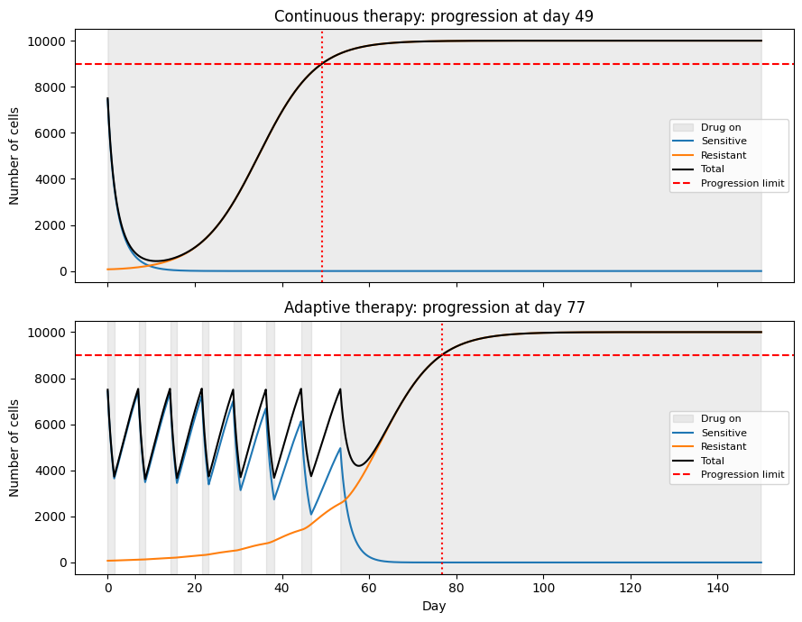

# Adaptive Therapy Simulation

Can changing *when* a cancer drug is given, instead of giving it nonstop, delay drug resistance?

Tumors contain drug-sensitive and drug-resistant cells that compete for space.
Continuous treatment kills the sensitive cells and lets resistant ones take over.
Adaptive therapy pauses treatment so sensitive cells keep resistant ones in check.
I built a model of this competition in Python and compared the two strategies.

## Results
| Strategy | Time to progression (days) | Drug days |
|---|---|---|
| Continuous | 49.2 | 49.2 |
| Adaptive | 76.7 | 35.5 |

In my model, adaptive therapy delayed progression by about 27 days (roughly 56% longer)
while using about 28% fewer drug days.

Adaptive therapy delays resistance but doesn't stop it. Each cycle, the sensitive cells
recover a little less while the resistant cells slowly grow. By about day 53, the tumor
can no longer shrink to half its starting size, the drug stays on, and the resistant
cells take over.

## How it works
- Logistic growth with a shared carrying capacity for sensitive and resistant cells
- A drug that only kills sensitive cells
- Adaptive rule: stop treatment when the tumor shrinks to 50% of its starting size, restart when it returns to 100%
- Progression = the first time the tumor grows past 120% of its starting size
- Simulated with Euler's method in Python (numpy, matplotlib)

## Limitations
This is a simplified two-population model with parameters chosen for illustration, not fit to patient data.

## Inspiration
Adaptive therapy research at Moffitt Cancer Center's Integrated Mathematical Oncology department.
